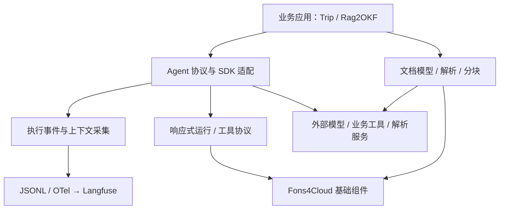

# Fons4AI

**让 Java AI 应用具备可管理的执行过程、人工确认与完整的追踪链路。**

Fons4AI 是一个基于 Java 21、Spring Boot 的 AI 应用基础框架，围绕 **Agent 运行、执行观测、文档处理** 三条路径组织能力。它将流式输出、取消、工具审批、父子 Agent 恢复和事件追踪封装到公共协议与适配模块，业务应用负责场景编排、提示词、工具与页面。

**[系统架构](#架构概览) · [核心设计](#核心设计) · [快速接入](#快速接入) · [应用项目](#应用项目)**

Java 21 · Spring Boot · AgentScope · Spring AI · LangChain4j · OpenTelemetry

## 架构概览



应用层组合 Agent 与文档能力，框架层承接执行生命周期和数据契约，Fons4Cloud 提供缓存与公共组件。完整分层与依赖见 [系统架构](docs/architecture.md)。

## 核心设计

| 工程问题 | 设计方式 | 深入阅读 |
| --- | --- | --- |
| 如何管理一次 Agent 执行？ | `Agent` / `AgentRun` 统一事件、结果、状态与取消；响应式运行管理协调会话占用、租约与取消句柄 | [运行协议与调用时序](docs/agent-runtime.md) |
| 工具需要人工确认时如何继续？ | 审批等待收口当前分段，保存待决定信息；AgentScope 适配关联父子 Agent、原工具调用与恢复上下文 | [状态与人工确认](docs/agent-runtime.md#状态与分段) |
| 如何解释模型与工具的执行过程？ | `@AgentObserved` 声明 RUN / STEP，Convention 映射业务身份；SDK 中间件采集模型、工具和 HITL 事件，输出到 JSONL 与 Langfuse | [采集架构与追踪时序](docs/observability.md) |
| 如何让不同解析器保留一致的文档来源？ | 统一文档与来源模型，按策略选择解析器，分块前后校验文档绑定、结构与策略身份 | [文档解析与分块设计](docs/document-processing.md) |

> [!NOTE]
> 当前 Trip 使用 AgentScope 适配路径。Spring AI、LangChain4j 适配的功能覆盖各有范围，不能将某条路径的审批、恢复或追踪能力视为所有适配器的共同保证。

## 模块导航

| 目录 | 职责 |
| --- | --- |
| [fons4ai-agent](fons4ai-agent/) | Agent 公共运行协议、AgentScope / Spring AI / LangChain4j 适配、可观测性 |
| [fons4ai-common](fons4ai-common/) | 公共 API、响应式任务运行管理、工具协议、OCR |
| [fons4ai-rag](fons4ai-rag/) | 通用文档模型、解析与分块编排、LangChain4j / Spring AI 适配、Spring AI PgVector 嵌入支持 |

## 快速接入

### 1. 安装框架依赖

准备 **JDK 21、Maven**，先按 [Fons4Cloud 构建说明](https://github.com/nauyiq/fons4cloud#快速接入) 安装基础依赖，再在本仓库根目录执行：

```bash
mvn install -DskipTests
```

### 2. 按需引入模块

例如，在业务应用中引入 AgentScope 适配：

```xml
<dependency>
    <groupId>com.fons.cloud.ai</groupId>
    <artifactId>fons4ai-agentscope-starter</artifactId>
    <version>1.0.0</version>
</dependency>
```

应用需要选择模型、装配业务 Agent 与工具，并提供运行所需的 Redis、状态存储等配置。可对照 [Trip 的接入位置](docs/applications.md#对照源码的四个位置) 和 [观测配置](docs/observability.md#接入配置) 继续阅读。

> [!TIP]
> 只了解架构时可直接阅读专题文档，无需先部署应用。上面的命令用于安装本地依赖，跳过了测试；框架各模块按需接入，没有统一的业务应用启动入口。

## 应用项目

| 项目 | 场景 | 框架在其中的作用 |
| --- | --- | --- |
| [Trip 智能差旅助手](https://github.com/nauyiq/fons4ai-trip) | 差旅信息查询、行程规划与管理 | Master / 子 Agent 协作、流式响应、工具审批和执行追踪 |
| [Rag2OKF 知识库应用](https://github.com/nauyiq/fons4ai-rag2okf) | 知识库、文档解析与分块管理 | 文档来源、解析策略和分块能力与业务流程衔接 |

详见 [应用关系、业务流程图与源码阅读路线](docs/applications.md)。

## 设计文档

| 主题 | 内容 |
| --- | --- |
| [系统架构](docs/architecture.md) | 分层、模块关系、适配边界与设计取舍 |
| [Agent 运行时](docs/agent-runtime.md) | 调用时序、执行状态、取消与人工确认 |
| [可观测性](docs/observability.md) | 采集链路、上下文传播、Langfuse 投影、排查方法 |
| [文档处理](docs/document-processing.md) | 格式识别、Parser 选择、来源与分块校验 |
| [应用项目](docs/applications.md) | Trip / Rag2OKF 接入关系、业务流程与源码阅读路线 |

<details>
<summary>依赖版本与实现范围</summary>

版本以 [根 POM](pom.xml) 为准：Spring Boot 3.5.8、AgentScope 2.0.3、Spring AI 1.1.2、Spring AI Alibaba 1.1.2.0、LangChain4j 1.11.0、OpenTelemetry 1.61.0；部分 LangChain4j 集成组件单独使用 beta 版本。

文档依据 2026-10-16 的 `master` 源码整理，代码基线为 `3944de9`，描述已有实现和应用接入关系。具体运行结果、模型效果与性能应结合相应场景验证。

</details>
