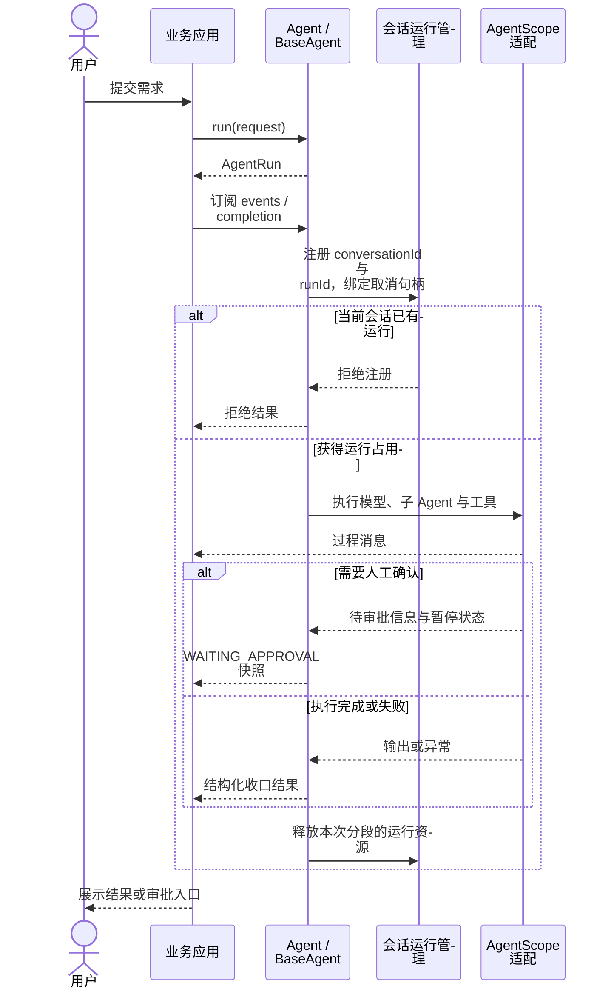
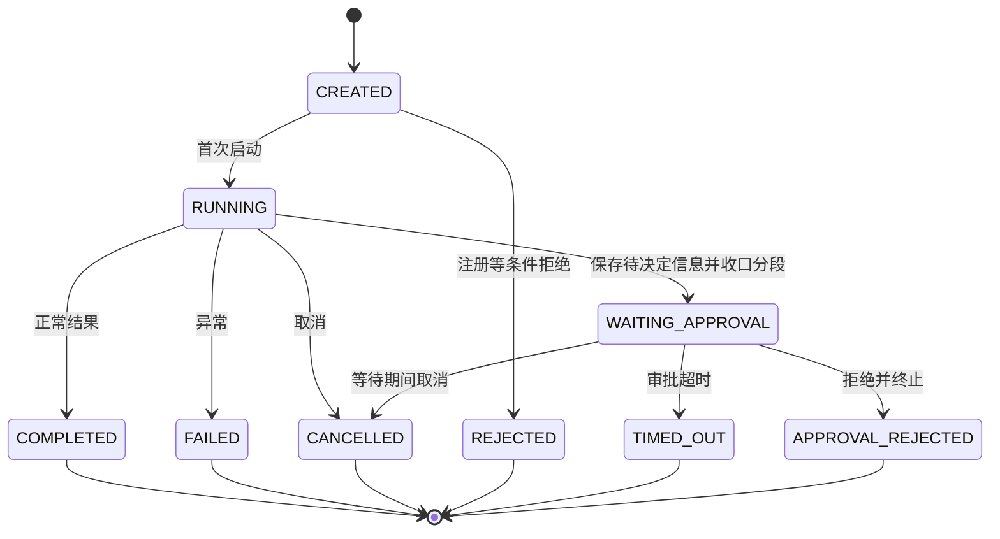

# Agent 运行时与人工确认

[返回 README](../README.md) · [架构](architecture.md) · [可观测性](observability.md)

## 一次调用包含什么

`Agent.run(request)` 返回 `AgentRun`。调用方通过同一 Run 的事件流观察过程，通过完成结果读取本次执行分段的收口状态，并可请求取消。`Agent.stream(request)` 在每次订阅时创建新 Run；`Agent.call(request)` 同步等待结构化结果，禁止在 Reactor 非阻塞线程里调用。

图中应用负责把事件交给前端，框架不直接规定 HTTP Controller 的业务接口。

## 状态与分段

图展示主要业务路径，全部状态转换约束以 [AgentRunStateMachine](../fons4ai-agent/fons4ai-agent-common/src/main/java/com/fons/cloud/ai/agent/model/runtime/AgentRunStateMachine.java) 为准。

`WAITING_APPROVAL` 是当前流分段结束，不是正常完成，也不是不可逆终态。提交人工决定后走恢复调用与新的执行分段；不能把上图理解成原 Run 内部无条件从等待切回运行。恢复需要对应 SDK 状态、审批身份与原工具调用的关联。

## 取消与并发边界

同一 `conversationId` 通过 `agent:` 命名空间参与运行管理，当前只允许一个正在执行的 Run。注册、绑定、取消和释放均携带运行标识，避免旧执行释放新执行的占用。具体租约与取消广播由 `ReactiveRunManager` 负责。

普通生成的事件订阅被取消时，`Agent.stream` 请求取消 Run；如果已经处于 `WAITING_APPROVAL`，断开当前连接不应把等待决定的执行误判为用户取消。流连接和执行分段因此需要分别处理。

## 子 Agent 审批为什么需要适配

子工具暂停后，父 Agent 的委派调用还需要与原来的子会话、工具调用 ID 对齐。只恢复子 Agent，不代表父委派自动保持 pending 或自动续跑。适配层需要保留执行关系、收集决定，并向正确的调用提交结果。

仓库保留两份可复查的手工验证说明：

- [本地子 Agent 审批验证](../fons4ai-agent/fons4ai-agentscope-starter/docs/subagent-approval-verification.md)：包括 `--scripted` 离线预检、批准、拒绝与新实例加载场景。
- [远程子 Agent 审批验证](../fons4ai-agent/fons4ai-agentscope-starter/docs/remote-subagent-approval-verification.md)：说明远程委派场景与运行条件。

这些入口包含原生能力探测和显式桥接验证，不能把桥接成功推导为 SDK 默认委派开箱即用，也不能推导为生产幂等、多副本故障恢复均已验证。本次文档编写没有重跑这些场景。
