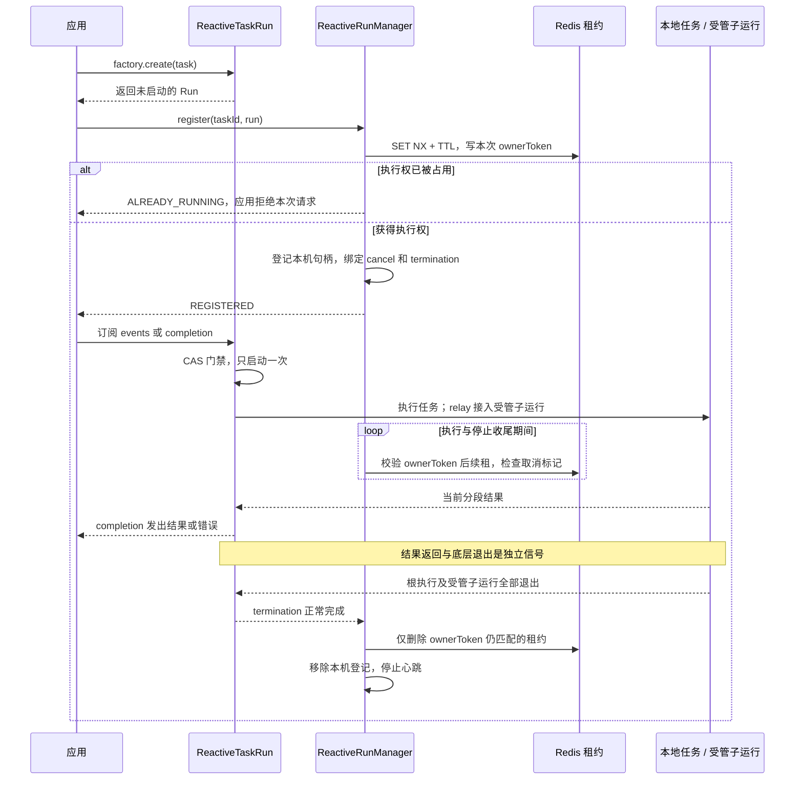
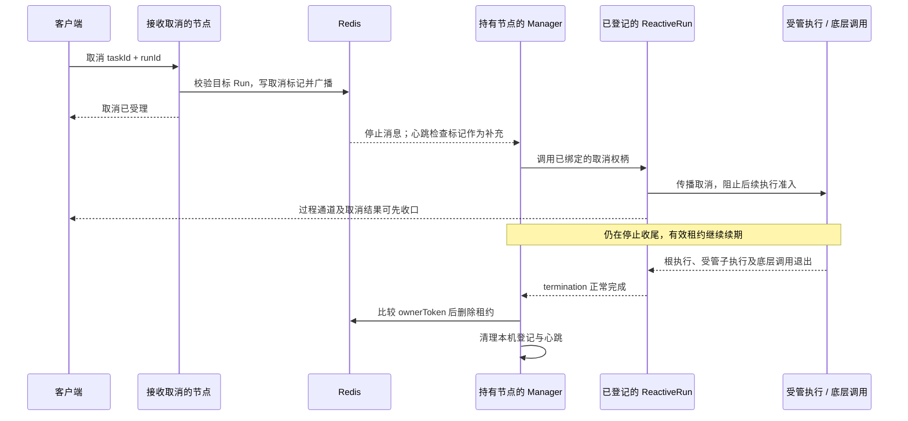
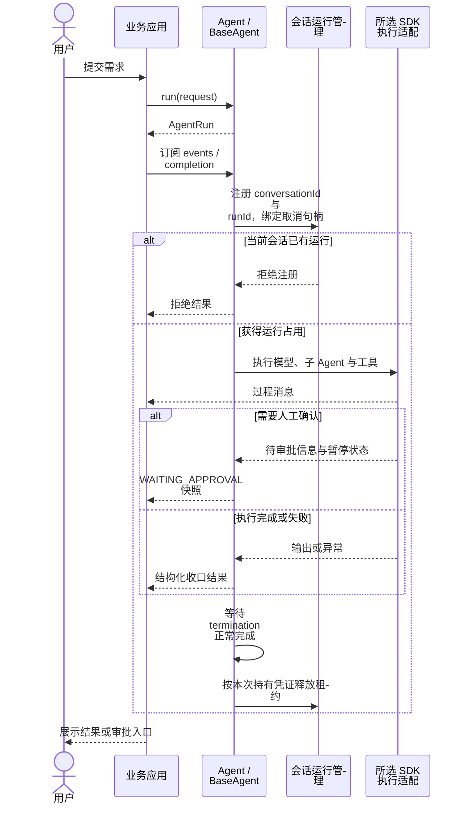
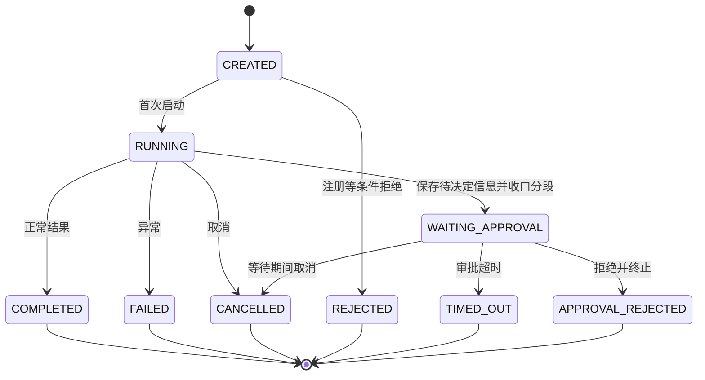

# 任务注册、运行生命周期与 Agent 适配

[返回 README](../README.md) · [架构](architecture.md) · [可观测性](observability.md)

## 通用运行契约

`ReactiveRun<E, R, S>` 用运行标识、状态、过程事件、结构化结果、取消和实际退出确认描述一次执行。普通任务、Agent 或其他执行框架可通过这个协议接入同一个 `ReactiveRunManager`；管理器不解释某个 SDK 的内部状态，也不查找其原生 Agent 实例。

下文先说明通用任务注册、启动、取消和续租，再说明公共 Agent 协议及当前 SDK 适配示例。`DefaultReactiveTaskRun` 提供普通任务的默认实现；其他实现须满足相同生命周期契约，不能只暴露一个 `Disposable` 就视为完整接入。

## 任务注册与执行的职责

注册回答“本次执行是否拥有互斥范围内的执行权”，运行句柄回答“任务如何启动、转发事件、返回结果和停止”。创建工厂不会自动注册 Redis；应用或领域适配层负责显式注册，底层 SDK 的执行差异由其适配代码处理。

| 组件 | 职责 | 不由它承担的工作 |
| --- | --- | --- |
| `DefaultReactiveTaskRunFactory` | 生成 Run 标识，创建未启动句柄，捕获运行扩展 | 不订阅任务、不申请租约 |
| `DefaultReactiveTaskRun` | 一次启动、事件转发、结果回放、取消传播、受管孩子与退出确认 | 不理解 Agent 的审批状态 |
| `ReactiveRunManager` | 本机登记、Redis 互斥、取消路由、续租和精确释放 | 不调度业务任务到工作节点、不持久化工作流 |
| `AgentTaskManager` / `BaseAgent` | 将 Agent 会话与错误码适配到通用管理器；先注册、绑定，再启动原生执行 | 不另建一套租约管理器 |
| SDK 执行适配（职责） | 将原生执行映射到公共事件、结果、取消与退出确认 | 不另建通用登记机制，不把取消等同于外部副作用撤销 |

### 从创建到启动

下面的主时序对应通用 `register(taskId, run)` 接入：取得 Redis 租约后绑定取消与 `termination()`，不订阅 `events()` 或 `completion()`。订阅者接入后，Run 通过 CAS 保证只启动一次，执行任务与可选结果处理器。



应用接入的简化伪代码：

```java
run = runFactory.create(task);               // 创建不执行
if (manager.register(taskId, run) != REGISTERED) {
    run.cancel();                           // 关闭本次未启动句柄
    return 拒绝本次请求;
}
return run.events();                        // 外层订阅才启动
// register 已独立观察 termination；其生命周期不依赖前端连接。
```

`scope.relay(childRun)` 在被订阅时登记孩子，先转发孩子的实时事件，事件结束后读取其结构化结果；它另外独立观察孩子的 `termination()`，直到真实退出才移除活动孩子。父 Run 的取消会传播给这些孩子。原生 SDK 内部的子节点也可由其执行适配汇总管理，不要求每个节点单独包装为 `ReactiveTaskRun`；具体实现见后面的 SDK 示例。

### 三个通道为什么分开

| 通道 | 是否触发启动 | 结束表示什么 |
| --- | --- | --- |
| `events()` | 首次订阅启动同一 Run | 当前过程通道结束；默认实现为实时单播，不回放历史 |
| `completion()` | 首次订阅启动同一 Run | 当前分段结果或错误已确定，可向晚订阅者回放；不代表业务成功或底层全部退出 |
| `termination()` | 不启动 | 根执行及受管子运行实际退出；正常完成才可释放执行权，确认异常则保留占用 |

`DefaultReactiveTaskRun` 等待根执行退出和活动孩子集合清空；其他 `ReactiveRun` 实现需要由执行适配汇总其底层任务的退出，向管理器提供同样可信的 `termination()`。通过这些分层约束，普通任务与 Agent 可使用同一管理协议。

退出确认只覆盖已接入生命周期的执行。业务自行 `subscribe()` 启动且未登记的独立任务，不会自动进入受管孩子集合；新增异步分支应通过 `relay` 或相应适配层接入。

### 互斥范围与执行身份

| 标识 | 用途 | 取值规则 |
| --- | --- | --- |
| `taskId` | 决定哪些请求互斥，作为租约查找范围 | 由应用或领域适配提供，建议使用业务命名空间区分不同互斥范围 |
| `runId` | 精确定位本次物理执行，避免旧取消影响后续 Run | 一次运行内保持不变，不同运行使用不同标识；不能只用业务对象 ID 代替 |
| `ownerToken` | 每次注册独立生成的持有凭证，限制续租和释放权 | `instanceId/registrationUUID:base64url(runId)` |

管理器按 `taskId` 决定互斥范围，并不限定它必须来自会话。OTel Trace ID 用于追踪，不能替代以上标识或作为执行权凭证。

## 取消与退出确认时序

同一 `taskId` 当前只允许一个持有执行权的 Run。多节点场景只在持有节点保存本地句柄；其他 HTTP 节点通过 Redis 消息和精确 Run 标记传递取消，不需要访问执行节点中的 SDK 原生对象。



图展示跨节点取消；命中本机登记时直接调用取消权柄。Redis 广播用于及时通知，取消标记用于覆盖广播遗漏和迟到绑定。取消已受理、`dispose()`、客户端断开、结果发出或 Trace Span 关闭，都不能代替真实退出确认。

已发出的底层调用可能仍在执行。SDK 适配需要区分“取消等待结果”和“实际执行退出”：只有已接入生命周期的工作真实退出，才能完成 `termination()`。取消不能保证撤销已经发生的预订、写库等外部副作用。

## 租约续期与旧执行隔离

Redis 租约键为 `fons4ai-reactor:run:lease:<base64url(taskId)>`，值为本次 `ownerToken`。本机 `ConcurrentHashMap` 保存对应登记和取消权柄；登记、取消、退出等复合状态由原子变量及 JUC 锁协调，不能只靠线程安全 Map 保证完整生命周期。

管理器使用 `ScheduledThreadPoolExecutor.scheduleWithFixedDelay()` 为每个本地登记安排心跳，同一登记的检查不重叠。这个线程池调度的是续租和取消检查；模型、工具与业务 Pipeline 仍在各自响应式链中执行。

下面是管理器核心规则的简化伪代码，实际实现还处理取消先于绑定、Redis 超时和失败重试：

```text
register(taskId, run):
  token = 每次注册生成的新凭证
  若 Redis.SET_NX(leaseKey(taskId), token, TTL) 失败：拒绝
  local = 保存本次登记(token, run.cancel)
  独立观察 run.termination：正常完成 -> release(local)
  启动该登记的心跳

heartbeat(local):
  若已确认退出：重试 release(local)，不再续租
  若已丢失租约或超过最后确认的有效期：请求取消，保留本机登记
  否则原子执行：仅 Redis.GET(key) == token 时 PEXPIRE(key, TTL)
  若凭证不匹配：记为租约丢失并请求取消
  续期成功且未超出原有效期：从请求发出前的时间计算新有效期
  检查取消标记，必要时请求取消

release(local):
  仅处理仍是原对象且已确认退出的登记
  Redis.compareAndSet(token, null)       // 不删除其他持有者的租约
  移除本机登记，停止心跳
```

每次注册的新凭证避免同节点、同 Run ID 的重复登记被旧回调误操作；后台回调携带原登记对象，释放前同时核对本机对象和 Redis 凭证。Redis 释放异常时保留本机登记，由心跳重试清理。

续租网络等待有独立超时，最后确认的有效期用单调时钟记录。临时 Redis 异常不会被视为续租成功；超过有效期后不可重新续活。租约丢失只触发取消和等待退出，不创建新租约。停止收尾且仍持有有效租约时继续续期，并重试失败的取消。

当前默认参数来自 `ReactiveRunProperties`：

```yaml
sys:
  reactor:
    run:
      lease-ttl: 90s
      heartbeat-interval: 20s
      operation-timeout: 5s
      heartbeat-threads: 4
```

心跳间隔不能超过 TTL 的三分之一，单次操作超时必须小于心跳间隔。这是本次采用的简化租约方案：进程崩溃后 Redis 占用会随 TTL 到期，但不会自动恢复业务状态。当前没有自动接管、业务写入的 fencing token 或完整的跨节点工作流恢复保证。

### Trip 接入示例

Trip 的外层 Pipeline 使用 `TRIP-WORKER:<conversationId>` 作为 `taskId`，公共 Agent 适配使用 `agent:<conversationId>`。两次登记覆盖不同执行边界，各自绑定对应的 Pipeline Run ID 或 Agent Run ID，不表示创建了两份相同的模型执行。

业务数据库仍有 `active_run_id` 而租约缺失或不可用时，Trip 保留业务占用并报告未知状态，避免直接放行新执行。这是应用的保护策略，不是管理器自动回收或恢复业务状态的通用保证。

## 新执行框架如何接入

通用管理器只接收任务标识、Run 标识、取消权柄和退出信号。各 SDK 可通过中间件、回调、监听器或自身执行句柄适配，复用现有 `ReactiveRun` 契约，不需要另建注册表或租约管理器。

| 接入内容 | 必须保证的语义 |
| --- | --- |
| 标识与注册 | 由业务确定 `taskId` 互斥范围，为本次执行提供稳定 `runId`；启动前取得执行权 |
| 启动与结果 | 句柄创建不提前执行，事件与结果订阅共用一次启动；`completion()` 可重放当前分段结果或错误 |
| 取消与准入 | 注册后、底层启动前绑定取消与退出信号；处理先取消后绑定的竞态，并阻止取消后的新执行 |
| 真实退出 | 汇总本次根执行及受管子执行；不能因观察订阅结束就提前完成 `termination()` |
| 状态与恢复 | SDK 状态映射到所用领域协议；审批、持久化与恢复由对应适配和业务处理，管理器不保存工作流状态 |

图中的执行适配表示职责分组，不是本次新增的接口。通用契约可复用，具体 SDK 的取消、子节点和恢复行为仍需分别接入与验证。

## 公共 Agent 协议接入

`Agent.run(request)` 返回实现公共运行协议的 `AgentRun`。`Agent.stream(request)` 在每次订阅时创建新 Run；`Agent.call(request)` 同步等待结构化结果，禁止在 Reactor 非阻塞线程里调用。以下是公共 Agent 模板的时序，具体执行交给所选 SDK 适配；审批路径只适用于支持该能力的适配器。



Agent 使用两阶段入口：`BaseAgent.startAction()` 先经 `AgentTaskManager.registerTask()` 占用会话，再绑定 `RuntimeActions` 的取消权柄和退出信号，最后调用适配器的 `streamExecute()`。这样即使取消早于原生订阅创建，后续绑定也能看到取消事实并阻止执行。

图中应用负责把事件交给前端，框架不直接规定 HTTP Controller 的业务接口。

## 状态与分段



图展示主要业务路径，全部状态转换约束以 [AgentRunStateMachine](../fons4ai-agent/fons4ai-agent-common/src/main/java/com/fons/cloud/ai/agent/model/runtime/AgentRunStateMachine.java) 为准。

`WAITING_APPROVAL` 是当前流分段结束，不是正常完成，也不是不可逆终态。提交人工决定后走恢复调用与新的执行分段；不能把上图理解成原 Run 内部无条件从等待切回运行。恢复需要对应 SDK 状态、审批身份与原工具调用的关联。

普通生成的事件订阅被取消时，`Agent.stream` 请求取消 Run；如果已经处于 `WAITING_APPROVAL`，断开当前连接不应把等待决定的执行误判为用户取消。流连接和执行分段因此需要分别处理。

## AgentScope 当前适配示例

| 通用职责 | 当前实现 |
| --- | --- |
| 原生根执行、节点和工具汇总 | `AgentScopeRuntimeActions` 维护本次活动执行，直到它们全部退出才完成退出确认 |
| 节点与模型生命周期接入 | `AgentScopeExecutionLifecycleMiddleware` 登记原生节点、检查执行准入并传播取消 |
| 单工具准入与真实返回 | `ToolExecutor` 最小源码补丁接入执行权柄，覆盖工具批次内的独立调用 |

AgentScope 原生子 Agent 不必各自包装成新的 `ReactiveTaskRun`：适配层在共享的 `AgentScopeRuntimeActions` 中登记对应 `RuntimeContext`。

已准入的外部工具请求可能仍在执行。AgentScope 适配将工具的真实执行与 SDK 的观察订阅分开计数：观察者取消或超时后，仍等待实际调用返回，才减少活动工具数。这里不保证撤销已经发生的预订、写库等外部副作用。

单工具的准入与真实退出通过 AgentScope 2.0.3 的 `ToolExecutor` 最小源码补丁接入。原因是 `onActing` 只包围工具批次，无法单独阻止取消后的串行尾部调用或重试，也无法准确确认已发出工具的退出；详细接入点见 [工具执行生命周期补丁](../fons4ai-agent/fons4ai-agentscope-starter/docs/patches/agentscope-2.0.3-tool-execution-lifecycle.md)。

## 按执行顺序读源码

### 通用任务层

| 阅读位置 | 重点方法与问题 |
| --- | --- |
| [DefaultReactiveTaskRunFactory](../fons4ai-common/fons4ai-common-reactor/src/main/java/com/fons/cloud/reactor/core/DefaultReactiveTaskRunFactory.java) | `create()` / `captureInterceptors()`：为什么创建不等于执行？ |
| [DefaultReactiveTaskRun](../fons4ai-common/fons4ai-common-reactor/src/main/java/com/fons/cloud/reactor/core/DefaultReactiveTaskRun.java) | `startOnce()` / `relayInternal()` / `confirmTermination()`：一次启动、孩子登记与退出如何衔接？ |
| [ReactiveRunManager](../fons4ai-common/fons4ai-common-reactor/src/main/java/com/fons/cloud/reactor/core/ReactiveRunManager.java) | `register()` / `bind()` / `cancel()` / `checkLocalRun()` / `releaseLocalRun()`：谁持有执行权，何时能释放？ |
| [ReactiveRunProperties](../fons4ai-common/fons4ai-common-reactor/src/main/java/com/fons/cloud/reactor/infrastructure/config/properties/ReactiveRunProperties.java) | 续租参数及启动校验 |

### 公共 Agent 适配

| 阅读位置 | 重点方法与问题 |
| --- | --- |
| [AgentTaskManager](../fons4ai-agent/fons4ai-agent-common/src/main/java/com/fons/cloud/ai/agent/core/AgentTaskManager.java) | 将会话映射成 `agent:` taskId，复用通用管理器 |
| [BaseAgent](../fons4ai-agent/fons4ai-agent-common/src/main/java/com/fons/cloud/ai/agent/core/BaseAgent.java) / [RuntimeActions](../fons4ai-agent/fons4ai-agent-common/src/main/java/com/fons/cloud/ai/agent/model/runtime/RuntimeActions.java) | `startAction()` / `safelyCompleteTask()` 与资源退出确认：为什么先绑定再执行？ |

### AgentScope 适配示例

| 阅读位置 | 重点方法与问题 |
| --- | --- |
| [AgentScopeRuntimeActions](../fons4ai-agent/fons4ai-agentscope-starter/src/main/java/com/fons/cloud/ai/agent/core/AgentScopeRuntimeActions.java) | `registerNode()` / `executeTool()` / `termination()`：原生节点与工具如何汇总退出？ |
| [AgentScopeExecutionLifecycleMiddleware](../fons4ai-agent/fons4ai-agentscope-starter/src/main/java/com/fons/cloud/ai/agent/infrastructure/middleware/AgentScopeExecutionLifecycleMiddleware.java) | 节点与模型生命周期接入；它负责执行控制，与 Trace 中间件职责不同 |

## 子 Agent 审批为什么需要适配

子工具暂停后，父 Agent 的委派调用还需要与原来的子会话、工具调用 ID 对齐。只恢复子 Agent，不代表父委派自动保持 pending 或自动续跑。适配层需要保留执行关系、收集决定，并向正确的调用提交结果。

仓库保留两份 AgentScope 场景的手工验证说明，作为具体 SDK 的能力探测参考：

- [本地子 Agent 审批验证](../fons4ai-agent/fons4ai-agentscope-starter/docs/subagent-approval-verification.md)：包括 `--scripted` 离线预检、批准、拒绝与新实例加载场景。
- [远程子 Agent 审批验证](../fons4ai-agent/fons4ai-agentscope-starter/docs/remote-subagent-approval-verification.md)：说明远程委派场景与运行条件。

这些入口包含原生能力探测和显式桥接验证，不能把桥接成功推导为 SDK 默认委派开箱即用，也不能推导为生产幂等、多副本故障恢复均已验证。本次文档编写没有重跑这些场景。
