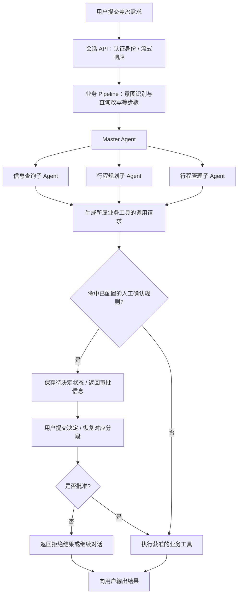

# 应用项目与源码阅读路线

[返回 README](../README.md) · [系统架构](architecture.md) · [可观测性](observability.md)

## 应用入口

| 内容 | 入口 | 当前口径 |
| --- | --- | --- |
| Trip 智能差旅助手 | [应用仓库](https://github.com/nauyiq/fons4ai-trip) | 本地源码中已定位框架接入、父子 Agent、工具审批与追踪装配 |
| Rag2OKF 知识库应用 | [应用仓库](https://github.com/nauyiq/fons4ai-rag2okf) | 本地源码中已定位知识库、文档、重新分块的业务入口 |

下述流程用于解释框架在应用中的职责与接入关系。实际结果取决于应用配置、模型行为和外部服务，本次未启动应用验证。

## Trip：从一次差旅需求向下看

场景示例：“下周从深圳去上海出差三天，先帮我查信息并整理行程，涉及写入操作时让我确认。”具体可执行操作以应用已配置的业务工具为准。

这是应用职责示意图。Master 按业务需要选择子 Agent，并非每次请求都会调用全部子 Agent；审批规则也不是对所有工具默认启用。

### 对照源码的四个位置

1. 应用仓库中的 `ConversationController`：`/api/conversation/stream`、打断与审批 replay 入口。
2. `AgentExecutePipeline`：业务 RUN 声明；意图识别、查询改写等 Handler 声明 STEP。
3. `MasterAgentConfig`：三个业务子 Agent、工具集、权限规则、原生 OTel 与 Fons 中间件。
4. `TripObservationConvention`：将业务请求与结果映射到统一观测上下文。

结合正常执行、工具审批和取消三个场景，可以分别理解业务闭环、人工控制和运行收口；复查时对照实际结果与关联 Trace。

## Rag2OKF：从文档到分块结果

从创建知识库、添加文档、查看解析结果和调整分块设置这条路径，理解文档来源与分块边界。业务入口为应用中的 `KnowledgeBaseController`、`DocumentController`、`RechunkController`；底层处理设计见 [文档处理专题](document-processing.md)。

当前路线围绕文档管理和处理能力；完整问答与效果评测需要另外检查相应实现和运行结果。

## 先看哪一部分

| 阅读目标 | 路线 |
| --- | --- |
| 两分钟了解项目 | README → 架构总览 → 选一个应用 |
| 了解 Agent 工程实现 | Trip 装配入口 → [运行时](agent-runtime.md) → [观测专题](observability.md) |
| 了解 RAG 数据处理 | Rag2OKF 文档入口 → [文档处理](document-processing.md) → Parser / Chunking 源码 |
| 复查运行证据 | 应用实际结果 → 关联标识 → JSONL / Langfuse → 对应源码 |

跨仓库接入核查基于 2026-10-16 的本地源码：Trip `d328b7a`，Rag2OKF `b4588d3`。远程默认分支后续可能变化；这些标识不代表本次执行了部署或端到端验证。
