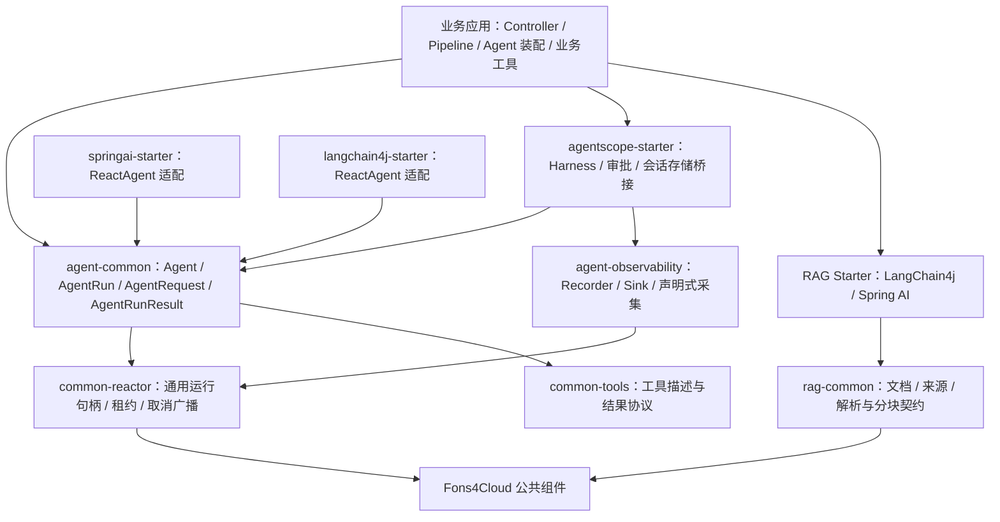

# Fons4AI 系统架构

[返回 README](../README.md) · [运行时](agent-runtime.md) · [可观测性](observability.md)

## 设计目标

业务应用要组合模型、工具、状态与用户交互，但这些能力的生命周期不同：流式连接可能先断开，工具可能等待审批，模型事件流结束也未必代表整个业务 Run 成功。Fons4AI 用公共运行协议承接这些边界，再把 SDK 差异放到适配层。

## 分层与依赖

箭头表示使用或依赖；应用选择需要的 Starter，不要求同时引入三个 Agent 实现。

## 三条核心路径

| 路径 | 框架职责 | 应用职责 |
| --- | --- | --- |
| Agent 执行 | 运行句柄、状态收口、会话互斥、取消、SDK 适配 | 业务 Agent 装配、提示词、工具与业务策略 |
| 执行观测 | RUN / STEP 采集、SDK 事件桥接、上下文与输出端 | Convention 身份映射、允许采集的业务快照、平台配置 |
| 文档处理 | 格式检测、解析器选择、统一文档模型、分块校验 | 文件管理、知识库归属、索引任务、检索和页面交互 |

### Agent 适配范围

三个 Starter 中均有实现，不能据此认为人工确认、子 Agent、持久化恢复和观测覆盖完全一致。当前 Trip 的主要路径是 `AgentScopeHarnessAgent`；可观测性专题重点解释这条已定位到应用装配位置的链路。

AgentScope 适配中还包含少量 SDK 同包名兼容源码，例如 `io/agentscope/core/state/ToolContextState.java`。阅读升级兼容性时应同时检查这些文件；不能只替换依赖版本就假定行为保持不变。

### 状态有不同的职责

- `AgentRunState` 表达一次 Agent 执行或执行分段的状态。
- `ReactiveRunManager` 协调运行占用、租约与取消句柄。
- AgentScope StateStore 保存 SDK 会话与待恢复的执行状态。
- Trace 记录描述发生过什么，不作为业务状态存储或审批决定的来源。

### 观测与执行分离

业务方法用注解声明边界，`ObservationConvention` 只读取公共业务状态；Recorder 与 Sink 不负责推进业务状态。JSONL 与 Langfuse 是同一组记录的不同出口，Langfuse 的节点数量不必等于 JSONL 的事件行数。

## 关键源码入口

| 关注点 | 入口 |
| --- | --- |
| Agent 调用协议 | [Agent.java](../fons4ai-agent/fons4ai-agent-common/src/main/java/com/fons/cloud/ai/agent/api/Agent.java) |
| 会话运行管理 | [AgentTaskManager.java](../fons4ai-agent/fons4ai-agent-common/src/main/java/com/fons/cloud/ai/agent/core/AgentTaskManager.java) |
| 通用运行管理 | [ReactiveRunManager.java](../fons4ai-common/fons4ai-common-reactor/src/main/java/com/fons/cloud/reactor/core/ReactiveRunManager.java) |
| AgentScope 适配 | [AgentScopeHarnessAgent.java](../fons4ai-agent/fons4ai-agentscope-starter/src/main/java/com/fons/cloud/ai/agent/core/AgentScopeHarnessAgent.java) |
| 声明式观测 | [观测自动配置模块](../fons4ai-agent/fons4ai-agent-observability/fons4ai-agent-observability-spring-boot-autoconfigure/) |
| 文档模型与编排 | [rag-common](../fons4ai-rag/fons4ai-rag-common/) |

## 为什么这样拆分

公共模块保留执行和数据契约，避免业务直接依赖某个 SDK 的内部事件。Starter 承担不同框架的装配和生命周期桥接，但不试图抹平所有框架差异。应用层保留业务编排与工具权限，避免将差旅规则或知识库管理固化进通用框架。

代价是适配层需要随 SDK 行为演进，尤其是审批恢复、上下文传播和同包兼容代码。判断兼容性应以具体场景验证为准。
