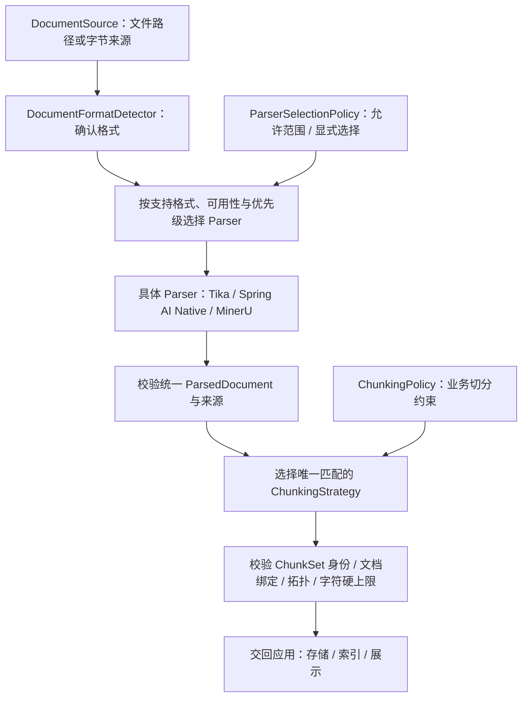

# 文档解析与分块设计

[返回 README](../README.md) · [系统架构](architecture.md)

## 为什么保留统一文档模型

不同解析器可能给出纯文本、Markdown、页面元素或表格。若分块直接依赖某个 SDK 的 Document，来源、页码和结构容易在转换中丢失。`rag-common` 使用 `ParsedDocument`、`DocumentBlock`、`SourceLocation` 等公共模型承接解析事实，具体解析和切分技术在 Starter 中适配。

## 处理流程

最后的存储和索引属于应用衔接。上图不能推导为任意 Starter 已完成全部知识库检索与问答链路。

## 关键决策

| 决策 | 行为与理由 |
| --- | --- |
| 先确定格式，再选解析器 | 统一处理未知格式、不支持格式与解析器不可用，避免各实现分别猜测 |
| 显式选择不改选其他 Parser | 保护调用方指定的解析策略与外部能力使用边界 |
| 自动选择有稳定顺序 | 按优先级降序，同优先级按 ID，避免 Spring 装配顺序影响结果 |
| 选中后执行失败不隐式降级 | 保留失败原因，不用另一解析器的不同结果掩盖异常 |
| 来源由解析调用托管 | 成功或失败都通过 `try (source)` 释放来源资源 |
| 分块按完整策略匹配唯一实现 | 多实现同时匹配视为装配冲突，不按注册顺序随意选一个 |
| 分块前封闭解析事实 | 固定文档归属和来源，分块后再校验结果是否绑定当前文档 |

## 模块边界

- `fons4ai-rag-common`：文档与分块模型、格式识别、解析和分块编排、MinerU 集成。
- `fons4ai-rag-langchain-starter`：Tika 解析、LangChain4j Document 适配、递归及来源感知切分实现。
- `fons4ai-rag-spring-ai-starter`：Spring AI 文档读取适配、切分器、PgVector 嵌入与限速支持。

这些实现的格式覆盖和分块策略各有范围，不能仅凭依赖存在宣称所有格式、表格和图像都已验证。MinerU 等外部能力也需要自己的服务与配置。

## 源码与验证入口

| 内容 | 入口 |
| --- | --- |
| 格式、Parser 选择与来源生命周期 | [DefaultDocumentParsingService](../fons4ai-rag/fons4ai-rag-common/src/main/java/com/fons/cloud/ai/rag/core/DefaultDocumentParsingService.java) |
| 分块编排与结果验收 | [DefaultDocumentChunkingService](../fons4ai-rag/fons4ai-rag-common/src/main/java/com/fons/cloud/ai/rag/core/DefaultDocumentChunkingService.java) |
| 公共文档模型 | [document 模型目录](../fons4ai-rag/fons4ai-rag-common/src/main/java/com/fons/cloud/ai/rag/model/document/) |
| LangChain4j 适配测试 | [测试目录](../fons4ai-rag/fons4ai-rag-langchain-starter/src/test/java/com/fons/cloud/ai/rag/) |
| Spring AI 适配测试 | [测试目录](../fons4ai-rag/fons4ai-rag-spring-ai-starter/src/test/java/com/fons/cloud/ai/rag/) |

现有测试入口可用于复查具体行为；本文没有将测试文件存在表述为本次测试通过。
