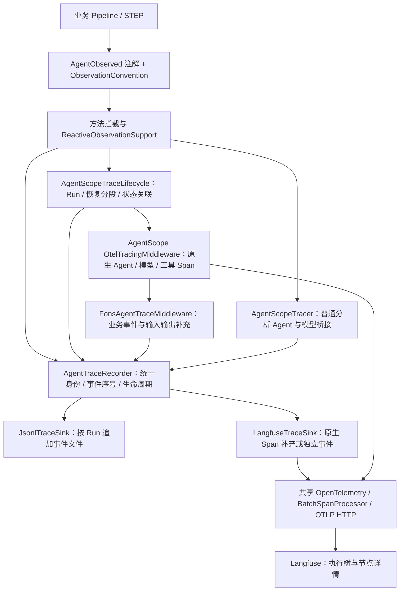
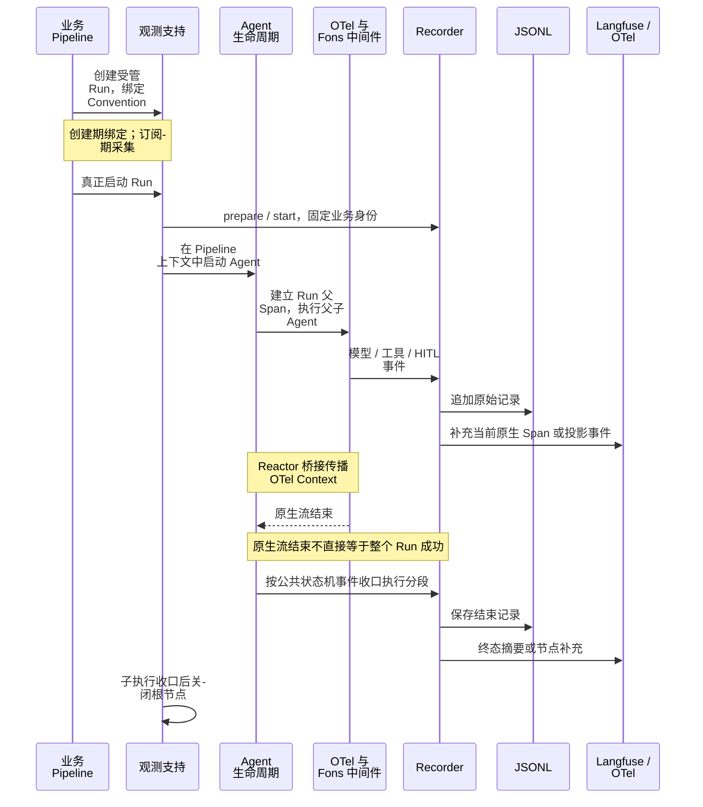

# Fons4AI 可观测性：从业务执行到 Langfuse

[返回 README](../README.md) · [Agent 运行时](agent-runtime.md) · [应用项目](applications.md)

## 要回答的问题

一次请求经过哪些业务步骤、由哪个 Agent 执行、调用了哪些模型和工具、在哪里等待人工确认、最终是成功还是取消？Fons4AI 将这些信息组织为业务 Run、步骤和 SDK 节点，再关联到同一条追踪链路。

当前专题对应 `agent-observability` 与 `agentscope-starter` 的实现。Trip 的 Pipeline、分析步骤与 Master / 子 Agent 装配提供了实际接入位置；这不意味着所有 Agent Starter 已有相同的采集覆盖。

## 采集架构



图中 Recorder 表示统一端口；启用两个 Sink 时，同一原始记录依次分发给两者。原生 Span 直接进入 OTel，Fons 的 Langfuse Sink 决定哪些数据补充到已有节点、哪些显示为独立事件。

## RUN、STEP 与 SDK 节点如何协作

| 层次 | 接入方式 | 负责什么 |
| --- | --- | --- |
| 业务 RUN | `@AgentObserved(kind = RUN)` | 对同步创建并返回的、尚未启动的 `ReactiveTaskRun` 绑定观测描述，真实启动后建立根节点 |
| 业务 STEP | `@AgentObserved(kind = STEP)` | 对可拦截的 `Mono` / `Flux` 方法在真实订阅时决定采集 |
| 业务映射 | `ObservationConvention` | 提供稳定身份、输入快照、结果映射和步骤输出，不推进业务流程 |
| Harness 执行 | `AgentScopeTraceLifecycle` + 中间件 | 运行与恢复分段、父子上下文、模型、工具、HITL 事件 |
| 普通分析 Agent | 可选 `AgentScopeTracer` | 在注解观测作用域内桥接 `AgentBase.call` 与模型调用；工具明细仍由 Harness 中间件负责 |

注解不是任意异步方法的通用追踪开关。RUN 不支持任意返回句柄或 `Mono<ReactiveTaskRun>`；类型级 STEP 注解也不会采集所有同步方法。方法必须经过实际拦截入口；接入时应确认代理与返回类型是否符合契约。

## 一次执行的时序



## 避免重复节点，同时保留原始事件

`NativeTraceContext` 将本次记录的投影意图放入 OTel Context，不使用全局事件缓存判断重复：

| 模式 | Langfuse 行为 |
| --- | --- |
| `ENRICH_RUN / ENRICH_AGENT / ENRICH_MODEL / ENRICH_TOOL_BATCH` | 在仍可记录的当前原生 Span 上补充业务身份、输入输出或元数据，不重复新建同义节点 |
| `AUDIT_ONLY` | 保留 Recorder 原始记录，跳过 Langfuse 投影 |
| `RUN_TERMINAL` | 创建精简终态事件，保留状态与错误摘要，不重复保存完整最终正文和堆栈 |
| `EVENT` | 默认独立事件模式，作为当前 Span 的子节点输出 |

没有有效当前 Span 时，`LangfuseTraceSink` 跳过输出，避免制造孤立 Trace。JSONL 不受这些投影模式影响，因此“JSONL 有记录、Langfuse 没有同名独立节点”可能是预期行为。

Harness 受管分支还有进程内的采集所有权标记：`AgentScopeTracer` 在这些分支透传，由中间件负责记录；普通分析 Agent 则由桥接 Tracer 采集。这样避免两条路径重复生成 Agent 或 Generation。

## 身份、上下文与状态

- Run 级身份包括 `runId`、`conversationId`、`messageId`、`userId`、Agent 名称和可选 `originRunId`；子 Agent 的执行者信息放在节点元数据中，避免覆盖根身份。
- `nodeId`、`parentNodeId` 与单个 Run 内递增的 `sequence` 用于表达事件关系；它们与 OTel 的 Trace ID / Span ID 是不同标识。
- `ContextPropagationOperator` 在 Reactor 订阅链上传播 OTel Context；生命周期对象另外保存 Run 上下文，使跨线程取消也能关联到正确节点。仅依靠线程局部变量不足以覆盖这条链路。
- `AgentRunStateChangedEvent` 决定 Agent Run 的开始和结束语义。等待人工审批映射为暂停分段，不能把 SDK 流自然结束当成业务成功。

## 接入配置

应用引入观测自动配置模块；`fons4ai-agentscope-starter` 已声明该依赖。最小本地事件记录配置：

```yaml
sys:
  agent:
    observability:
      enabled: true
      jsonl:
        enabled: true
        directory: logs/agent-traces
```

按需启用 Langfuse 与普通 Agent 桥接。下例与上例合并到同一 `observability` 节点：

```yaml
langfuse:
  enabled: true
  endpoint: ${LANGFUSE_OTLP_TRACES_ENDPOINT}
  access-id: ${LANGFUSE_PUBLIC_KEY}
  access-secret: ${LANGFUSE_SECRET_KEY}
  service-name: my-agent-app
agentscope-tracer:
  enabled: true
```

`endpoint` 是完整 OTLP/HTTP traces 接收地址，初始化器不会自动补路径。`AgentObservabilityGlobalInitializer` 在 Bean 创建前建立共享 SDK，使用批量 Span Processor 与 OTLP HTTP Exporter；现有全局 OTel 已设置且 `override-global` 为默认 `false` 时会复用它，因此要确认该实例本身已配置正确出口。

Harness Agent 需要实际装配原生 `OtelTracingMiddleware` 与 Fons 中间件。自动配置 Bean 的存在不等于应用的每个 Agent 都已接入。Trip 的 `MasterAgentConfig.commonBuilder()` 为 Master 和子 Agent 统一完成这项装配；`TripObservationConvention` 负责业务 Pipeline 的映射。

## 可靠性与已知边界

Recorder 分别隔离各 Sink 的输出异常；一个 Sink 失败不阻止另一个 Sink 和 Agent 主流程。`start` / `finish` 幂等，单 Run 事件通过生命周期锁生成递增序号。

异常隔离不等于完全无成本：JSONL 当前同步追加文件，Recorder 依次调用 Sink，没有独立的持久化队列、自动重放或丢失补偿保证。OTel 批量导出也不等于已经验证了故障场景下的可靠送达。启动时启用了 Langfuse 却缺少必填配置会报配置错误，不能把运行期 fail-open 理解为忽略全部启动错误。

Convention 应选择允许记录的字段。声明式观测支持对结构化快照中的部分敏感键名脱敏，但不覆盖任意提示词正文、工具返回和全部业务隐私；仍需按实际采集路径审查内容。公开演示应使用可公开的输入输出和只读 Trace 分享。

## 如何检查一次演示

1. 在业务页面发起一次请求，记录会话和业务运行标识。
2. JSONL 中确认开始、步骤或 SDK 事件、结束记录的身份一致且序号递增。
3. Langfuse 中检查 Pipeline、分析步骤、Master / 子 Agent、模型与工具的父子关系，确认没有重复的同义 Generation。
4. 触发一次人工确认，检查暂停及恢复分段；再检查取消或失败时的结束状态。
5. 若没有 Trace，依次核对开关、Sink、共享 OTel 出口、实际中间件装配和上下文传播；若有 JSONL 无独立事件节点，再核对投影模式。

这是可复查步骤，不是本次已完成的端到端验证报告。

## 源码导航

| 内容 | 源码 |
| --- | --- |
| 注解契约 | [AgentObserved](../fons4ai-agent/fons4ai-agent-observability/fons4ai-agent-observability-core/src/main/java/com/fons/cloud/ai/agent/observability/annotation/AgentObserved.java) |
| 业务映射接口 | [ObservationConvention](../fons4ai-agent/fons4ai-agent-observability/fons4ai-agent-observability-core/src/main/java/com/fons/cloud/ai/agent/observability/api/ObservationConvention.java) |
| 原始记录与异常隔离 | [DefaultAgentTraceRecorder](../fons4ai-agent/fons4ai-agent-observability/fons4ai-agent-observability-core/src/main/java/com/fons/cloud/ai/agent/observability/core/DefaultAgentTraceRecorder.java) |
| Langfuse 投影 | [LangfuseTraceSink](../fons4ai-agent/fons4ai-agent-observability/fons4ai-agent-observability-core/src/main/java/com/fons/cloud/ai/agent/observability/core/LangfuseTraceSink.java) |
| RUN / STEP 生命周期 | [ReactiveObservationSupport](../fons4ai-agent/fons4ai-agent-observability/fons4ai-agent-observability-spring-boot-autoconfigure/src/main/java/com/fons/cloud/ai/agent/observability/autoconfigure/instrumentation/ReactiveObservationSupport.java) |
| 共享 OTel 初始化 | [AgentObservabilityGlobalInitializer](../fons4ai-agent/fons4ai-agent-observability/fons4ai-agent-observability-spring-boot-autoconfigure/src/main/java/com/fons/cloud/ai/agent/observability/autoconfigure/AgentObservabilityGlobalInitializer.java) |
| AgentScope Run 追踪 | [AgentScopeTraceLifecycle](../fons4ai-agent/fons4ai-agentscope-starter/src/main/java/com/fons/cloud/ai/agent/infrastructure/observability/AgentScopeTraceLifecycle.java) |
| AgentScope 模型与工具事件 | [FonsAgentTraceMiddleware](../fons4ai-agent/fons4ai-agentscope-starter/src/main/java/com/fons/cloud/ai/agent/infrastructure/middleware/FonsAgentTraceMiddleware.java) |
