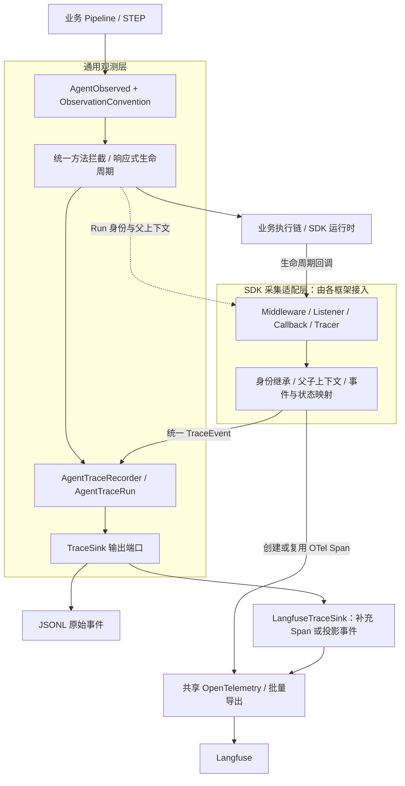
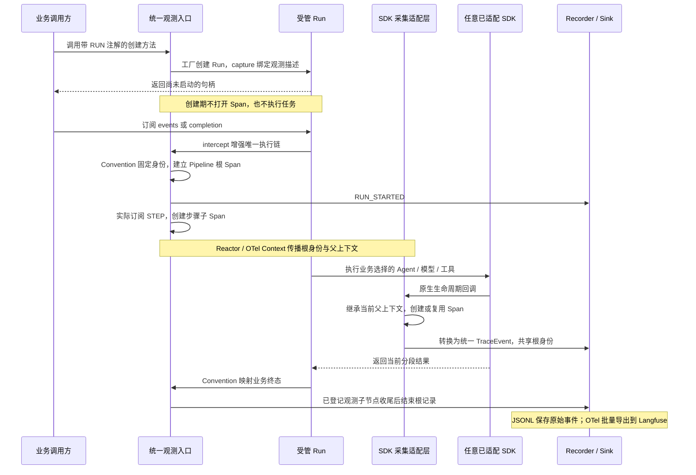

# Fons4AI 可观测性：从业务执行到 Langfuse

[返回 README](../README.md) · [Agent 运行时](agent-runtime.md) · [应用项目](applications.md)

## 要回答的问题

一次请求经过哪些业务步骤、由哪个 Agent 执行、调用了哪些模型和工具、在哪里等待人工确认、最终是成功还是取消？Fons4AI 将这些信息组织为业务 Run、步骤和 SDK 节点，再关联到同一条追踪链路。

本文先说明 `agent-observability` 的通用采集契约，再以 AgentScope 说明当前 SDK 适配。注解入口、事件模型、Recorder 与 Sink 可由不同 Agent 框架复用；模型、工具及原生子 Agent 的采集需要各 SDK 提供相应适配。Trip 是当前接入示例，不限定通用层的业务或 SDK 类型。

## 采集架构



图中的“SDK 采集适配层”是职责分组，表示各 SDK 使用自己的扩展点接入，并非代码里新增了同名接口。SDK 已有原生 Span 时复用并补充；没有相应 Span 时，由采集适配代码按公共上下文建立节点。不同 SDK 的扩展方式可以不同，通用事件与输出端口保持一致。

启用多个 Sink 时，Recorder 将同一原始记录依次分发给它们。原生或适配器建立的 Span 进入共享 OTel，`LangfuseTraceSink` 决定哪些事件补充到已有节点、哪些显示为独立事件；更换输出位置可通过 `TraceSink` 扩展。

## RUN、STEP 与 SDK 节点如何协作

| 层次 | 接入方式 | 负责什么 |
| --- | --- | --- |
| 业务 RUN | `@AgentObserved(kind = RUN)` | 对同步创建并返回的、尚未启动的 `ReactiveTaskRun` 绑定观测描述，真实启动后建立根节点 |
| 业务 STEP | `@AgentObserved(kind = STEP)` | 对可拦截的 `Mono` / `Flux` 方法在真实订阅时决定采集 |
| 业务映射 | `ObservationConvention` | 提供稳定身份、输入快照、结果映射和步骤输出，不推进业务流程 |
| SDK 节点采集 | 各 SDK 的中间件、监听器、回调或 Tracer 适配 | 继承根身份与父上下文，把 Agent、模型、工具等原生生命周期转换为公共事件 |
| SDK 独立入口 | 由对应适配代码建立 Run 观测作用域 | 未使用业务 RUN 注解时仍可接入 Recorder；开始、暂停、取消和结束需遵守公共语义 |

注解不是任意异步方法的通用追踪开关。RUN 不支持任意返回句柄或 `Mono<ReactiveTaskRun>`；类型级 STEP 注解也不会采集所有同步方法。方法必须经过实际拦截入口；接入时应确认代理与返回类型是否符合契约。

### 业务接入伪代码

业务接入的简化伪代码如下。RUN 方法必须经过 Spring 代理，同步创建并返回一个尚未启动的 `ReactiveTaskRun`；STEP 方法返回 `Mono` / `Flux`。

```java
@AgentObserved(name = "app.pipeline", kind = RUN)
createRun(request) {
    return runFactory.create(scope -> pipeline.execute(request, scope));
}

@AgentObserved(kind = STEP)
rewrite(context) {
    return Mono.defer(() -> rewriteService.execute(context));
}
// Convention 单独映射：runId ← request.runId，终态 ← 本次业务结果。
```

## 统一入口如何保持业务独立

业务只保留注解与一个 Convention 实现。Convention 不发起模型调用、不查询数据库、不更改请求或执行顺序，只读取已经存在的公共业务状态。框架不需要知道 Trip 的领域对象，Trip 的 Pipeline 也不需要调用 Recorder、创建 Span 或持有 `traceSupport`。

实现采用 Spring AOP 的 `MethodInterceptor` 与自动代理创建器；统一入口是 `AgentObservationInterceptor`，并非在每个业务类里添加切面逻辑。代理优先使用接口代理，以覆盖当前业务中继承的 final 模板方法；接入仍须通过代理暴露的方法，`new` 对象或类内部自调用不会自动得到同样的拦截。

RUN 的创建和执行发生在两个时点：方法调用时还没有真正的异步执行，只有工厂返回的句柄；订阅时才有执行链。因此拦截器先把声明交给工厂，再由通用运行扩展在唯一根订阅前建立观测。简化伪代码如下，省略了异常隔离、绑定校验与关闭计数。

```text
创建期：
  AOP.beginCreation(注解, 调用描述, Convention)
  run = 调用业务创建方法()                 // 工厂 capture 声明到这个 Run
  AOP.endCreation(run)                   // 校验返回句柄，清理创建期栈

执行期：
  runtime.startOnce():
    execution = task.execute + resultHandler
    execution = capturedInterceptor.intercept(scope, execution)
      // Convention 映射身份，建立 RunScope，把 OTel Context 写入 Reactor Context
    runtime.subscribe(execution)         // 唯一根订阅仍由运行时持有
```

创建期的 `ThreadLocal` 栈只负责同步绑定，方法退出时清理；跨线程执行依赖 Reactor Context 与 OTel 桥接。不能把创建期栈当成跨请求上下文，也不能在观测扩展里自行 `subscribe()`、`block()` 或 `retry()` 推动业务。

在 Trip 中，`TripObservationConvention` 将请求的业务 `runId` 用作根身份，把 common-reactor 的 `runId` 放在 `pipelineRunId` 属性里；`WAITING_APPROVAL` 映射为 `SUSPENDED`。因此“任务链正常返回了一个结果”不直接等于“业务成功”。

### 关键设计

- **创建与执行分开**：工厂通过中立的 `ReactiveTaskInterceptor` 扩展绑定观测，首次启动才采集，避免重复订阅造成业务重跑。
- **身份与父子关系分开**：整条链共享业务 Run 身份，每个分支显式继承自己的 OTel 父上下文；兄弟节点不会沿上一分支串接。
- **原始事件与展示分开**：Recorder 分发给 Sink；Langfuse 优先补充已有原生 Span，避免同一次模型调用出现重复节点。Sink 输出异常分别隔离。
- **声明与 SDK 采集可组合**：RUN / STEP 覆盖业务边界，SDK 适配补充内部节点；只使用 SDK 入口时，由其适配代码负责根作用域和身份，不能依赖某个特定框架的类。

## 一次执行的时序



这里的“子执行收口”指已经向观测 `RunScope` 登记的子节点完成观测收尾。`retain()` / 幂等释放计数用于防止根 Span 提前结束；它不管理执行权，也不能替代任务运行的 `termination()`。外部工具真实退出与租约释放由 [运行时生命周期](agent-runtime.md#取消与退出确认时序) 负责。

## 新 SDK 如何复用这套采集

通用层继续复用 `@AgentObserved`、`ObservationConvention`、`ReactiveTaskInterceptor`、`ReactiveObservationSupport`、Recorder、事件模型、Sink 与 OTel 出口。SDK 适配层需要完成以下映射：

| 适配内容 | 需要遵守的规则 |
| --- | --- |
| 生命周期入口 | 使用 SDK 提供的扩展点观察真实调用；不额外订阅或重跑业务，采集异常按 fail-open 处理 |
| 身份与上下文 | 已有业务 Run 时复用其身份和 Recorder；从当前父上下文分支，不能用子 Agent 身份覆盖根身份 |
| 事件与状态 | 将模型、工具、检索、人工交互等映射为 `TraceEvent`；业务结果或状态决定终态，原生流结束不直接等于成功 |
| 节点与关闭 | 原生 OTel 与自建 Span 明确采集归属，避免重复节点；接入共享作用域的子节点需要配对登记和收尾 |

图中表示的是以上复用关系。AgentScope 已有对应的 SDK 适配；Spring AI、LangChain4j 或后续框架需要分别核对其扩展点和实际覆盖，不能由主图推断它们已经具有同等采集能力。本次仅调整设计说明，没有新增适配接口或修改 SDK 接入代码。

## AgentScope 当前适配示例

下表将通用职责对应到当前已有类；其他框架可以使用各自的实现方式。

| 通用职责 | AgentScope 当前实现 |
| --- | --- |
| Run / 恢复分段与业务状态关联 | `AgentScopeTraceLifecycle` |
| Agent、模型、工具的原生 Span | SDK 的 `OtelTracingMiddleware` |
| 公共事件、输入输出与 HITL 补充 | `FonsAgentTraceMiddleware` |
| 普通分析 Agent 与模型桥接 | 可选 `AgentScopeTracer`，覆盖 `AgentBase.call` 与模型调用；工具明细由 Harness 中间件负责 |

### 不使用注解时能采集什么

注解与中间件相互补充，可以按需要选择采集范围：

| 接入方式 | 追踪入口与范围 |
| --- | --- |
| 仅装配 Harness 的原生 OTel 与 Fons 中间件 | `AgentScopeTraceLifecycle` 建立 Agent Run Span，Fons 中间件准备独立 Recorder 权柄，采集 Master / 子 Agent、模型、工具与 HITL |
| 业务 RUN + Harness 中间件 | Pipeline 建立根作用域；Agent Run Span 作为它的子节点，复用根 Recorder 和业务身份，不另开一条同义业务 Trace |
| 业务 RUN / STEP + 分析 Agent 桥接 + Harness 中间件 | 实际执行的问题改写、意图识别等步骤与 Master 一并进入 Pipeline 的树；跳过的步骤不建 Span |

AgentScope Harness 分支的采集所有权标记让 `AgentScopeTracer` 透传该分支，由中间件采集；普通分析 Agent 则由桥接采集。启用注解不意味着可以删除 SDK 中间件，单独装配 SDK 中间件也不会自动感知任意业务步骤。

审批等待会结束当前物理执行分段。恢复以新的 Run 执行，使用会话与 `originRunId` 关联此前分段，不跨人工等待期一直持有根 Span 或执行租约。

## 避免重复节点，同时保留原始事件

`NativeTraceContext` 将本次记录的投影意图放入 OTel Context，不使用全局事件缓存判断重复：

| 模式 | Langfuse 行为 |
| --- | --- |
| `ENRICH_RUN / ENRICH_AGENT / ENRICH_MODEL / ENRICH_TOOL_BATCH` | 在仍可记录的当前原生 Span 上补充业务身份、输入输出或元数据，不重复新建同义节点 |
| `AUDIT_ONLY` | 保留 Recorder 原始记录，跳过 Langfuse 投影 |
| `RUN_TERMINAL` | 创建精简终态事件，保留状态与错误摘要，不重复保存完整最终正文和堆栈 |
| `EVENT` | 默认独立事件模式，作为当前 Span 的子节点输出 |

没有有效当前 Span 时，`LangfuseTraceSink` 跳过输出，避免制造孤立 Trace。JSONL 不受这些投影模式影响，因此“JSONL 有记录、Langfuse 没有同名独立节点”可能是预期行为。

AgentScope 中通过采集所有权标记协调中间件与桥接 Tracer，见上面的适配示例。新 SDK 也需要明确各类节点的采集归属；具体标记机制不属于通用 Recorder 契约。

## 身份、上下文与状态

- Run 级身份包括 `runId`、`conversationId`、`messageId`、`userId`、Agent 名称和可选 `originRunId`；子 Agent 的执行者信息放在节点元数据中，避免覆盖根身份。
- `nodeId`、`parentNodeId` 与单个 Run 内递增的 `sequence` 用于表达事件关系；它们与 OTel 的 Trace ID / Span ID 是不同标识。
- `ContextPropagationOperator` 在 Reactor 订阅链上传播 OTel Context；生命周期对象另外保存 Run 上下文，使跨线程取消也能关联到正确节点。仅依靠线程局部变量不足以覆盖这条链路。
- 通用注解入口通过 Convention 映射业务权威结果；接入公共 Agent 协议的 SDK 适配还可使用 `AgentRunStateChangedEvent` 对齐状态。等待人工审批映射为暂停分段，不能把 SDK 流自然结束当成业务成功。

## 接入配置

应用引入观测自动配置模块并装配所选 SDK 的采集适配。以下配置属于通用观测层；`fons4ai-agentscope-starter` 已声明该模块依赖。最小本地事件记录配置：

```yaml
sys:
  agent:
    observability:
      enabled: true
      jsonl:
        enabled: true
        directory: logs/agent-traces
```

按需启用 Langfuse。下例与上例合并到同一 `observability` 节点：

```yaml
langfuse:
  enabled: true
  endpoint: ${LANGFUSE_OTLP_TRACES_ENDPOINT}
  access-id: ${LANGFUSE_PUBLIC_KEY}
  access-secret: ${LANGFUSE_SECRET_KEY}
  service-name: my-agent-app
```

`endpoint` 是完整 OTLP/HTTP traces 接收地址，初始化器不会自动补路径。`AgentObservabilityGlobalInitializer` 在 Bean 创建前建立共享 SDK，使用批量 Span Processor 与 OTLP HTTP Exporter；现有全局 OTel 已设置且 `override-global` 为默认 `false` 时会复用它，因此要确认该实例本身已配置正确出口。

AgentScope 的普通 Agent 桥接是 SDK 专属配置，按需追加到同一 `observability` 节点：

```yaml
agentscope-tracer:
  enabled: true
```

AgentScope Harness Agent 需要实际装配原生 `OtelTracingMiddleware` 与 Fons 中间件。自动配置 Bean 的存在不等于应用的每个 Agent 都已接入。Trip 的 `MasterAgentConfig.commonBuilder()` 为 Master 和子 Agent 统一完成这项装配；`TripObservationConvention` 负责业务 Pipeline 的映射。其他 SDK 使用各自的装配入口，不需要依赖这些 AgentScope 类。

## 可靠性与已知边界

Recorder 分别隔离各 Sink 的输出异常；一个 Sink 失败不阻止另一个 Sink 和 Agent 主流程。`start` / `finish` 幂等，单 Run 事件通过生命周期锁生成递增序号。

异常隔离不等于完全无成本：JSONL 当前同步追加文件，Recorder 依次调用 Sink，没有独立的持久化队列、自动重放或丢失补偿保证。OTel 批量导出也不等于已经验证了故障场景下的可靠送达。启动时启用了 Langfuse 却缺少必填配置会报配置错误，不能把运行期 fail-open 理解为忽略全部启动错误。

Convention 应选择允许记录的字段。声明式观测支持对结构化快照中的部分敏感键名脱敏，但不覆盖任意提示词正文、工具返回和全部业务隐私；仍需按实际采集路径审查内容。公开演示应使用可公开的输入输出和只读 Trace 分享。

## 如何检查一次演示

1. 在业务页面发起一次请求，记录会话和业务运行标识。
2. JSONL 中确认开始、步骤或 SDK 事件、结束记录的身份一致且序号递增。
3. Langfuse 中检查业务 Pipeline、分析步骤、父子 Agent、模型与工具的父子关系，确认没有重复的同义 Generation。
4. 触发一次人工确认，检查暂停及恢复分段；再检查取消或失败时的结束状态。
5. 若没有 Trace，依次核对开关、Sink、共享 OTel 出口、实际中间件装配和上下文传播；若有 JSONL 无独立事件节点，再核对投影模式。

这是可复查步骤，不是本次已完成的端到端验证报告。

## 按执行顺序读源码

先读本篇的执行时序，再按下表从入口追到出口。`ReactiveTaskInterceptor` 是运行时与观测模块之间的中立接口；common-reactor 无需依赖注解、Recorder 或 Langfuse。

### 通用层

| 内容 | 源码 |
| --- | --- |
| 注解契约 | [AgentObserved](../fons4ai-agent/fons4ai-agent-observability/fons4ai-agent-observability-core/src/main/java/com/fons/cloud/ai/agent/observability/annotation/AgentObserved.java) |
| 业务映射接口 | [ObservationConvention](../fons4ai-agent/fons4ai-agent-observability/fons4ai-agent-observability-core/src/main/java/com/fons/cloud/ai/agent/observability/api/ObservationConvention.java) |
| 1. Spring 代理装配：筛选携带声明的 Bean | [AgentObservationAutoProxyCreator](../fons4ai-agent/fons4ai-agent-observability/fons4ai-agent-observability-spring-boot-autoconfigure/src/main/java/com/fons/cloud/ai/agent/observability/autoconfigure/instrumentation/AgentObservationAutoProxyCreator.java) |
| 2. 统一方法拦截：RUN 绑定、STEP 订阅包装 | [AgentObservationInterceptor](../fons4ai-agent/fons4ai-agent-observability/fons4ai-agent-observability-spring-boot-autoconfigure/src/main/java/com/fons/cloud/ai/agent/observability/autoconfigure/instrumentation/AgentObservationInterceptor.java) |
| 3. 工厂与运行时之间的中立扩展契约 | [ReactiveTaskInterceptor](../fons4ai-common/fons4ai-common-reactor/src/main/java/com/fons/cloud/reactor/api/ReactiveTaskInterceptor.java) |
| RUN / STEP 生命周期 | [ReactiveObservationSupport](../fons4ai-agent/fons4ai-agent-observability/fons4ai-agent-observability-spring-boot-autoconfigure/src/main/java/com/fons/cloud/ai/agent/observability/autoconfigure/instrumentation/ReactiveObservationSupport.java) |
| 4. 原始记录与 Sink 异常隔离 | [DefaultAgentTraceRecorder](../fons4ai-agent/fons4ai-agent-observability/fons4ai-agent-observability-core/src/main/java/com/fons/cloud/ai/agent/observability/core/DefaultAgentTraceRecorder.java) |
| 5. Langfuse 投影：补充原生 Span 或输出事件 | [LangfuseTraceSink](../fons4ai-agent/fons4ai-agent-observability/fons4ai-agent-observability-core/src/main/java/com/fons/cloud/ai/agent/observability/core/LangfuseTraceSink.java) |
| 启动前置：共享 OTel 初始化与导出器 | [AgentObservabilityGlobalInitializer](../fons4ai-agent/fons4ai-agent-observability/fons4ai-agent-observability-spring-boot-autoconfigure/src/main/java/com/fons/cloud/ai/agent/observability/autoconfigure/AgentObservabilityGlobalInitializer.java) |

### AgentScope 适配示例

| 内容 | 源码 |
| --- | --- |
| Run 追踪：继承作用域、恢复分支与状态收口 | [AgentScopeTraceLifecycle](../fons4ai-agent/fons4ai-agentscope-starter/src/main/java/com/fons/cloud/ai/agent/infrastructure/observability/AgentScopeTraceLifecycle.java) |
| 模型与工具事件补充 | [FonsAgentTraceMiddleware](../fons4ai-agent/fons4ai-agentscope-starter/src/main/java/com/fons/cloud/ai/agent/infrastructure/middleware/FonsAgentTraceMiddleware.java) |
| 普通分析 Agent 与模型桥接 | [AgentScopeTracer](../fons4ai-agent/fons4ai-agentscope-starter/src/main/java/com/fons/cloud/ai/agent/infrastructure/observability/AgentScopeTracer.java) |
